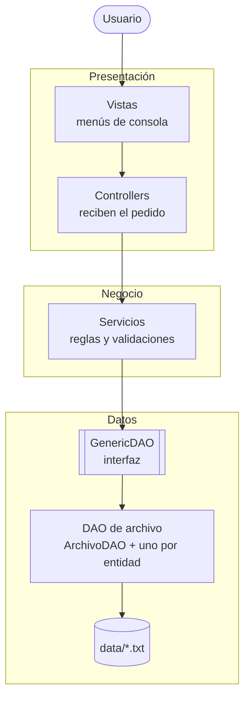
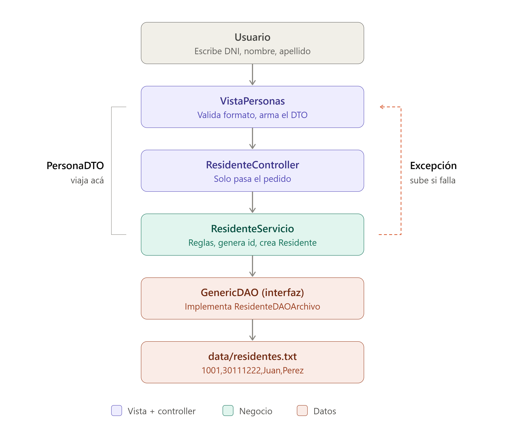
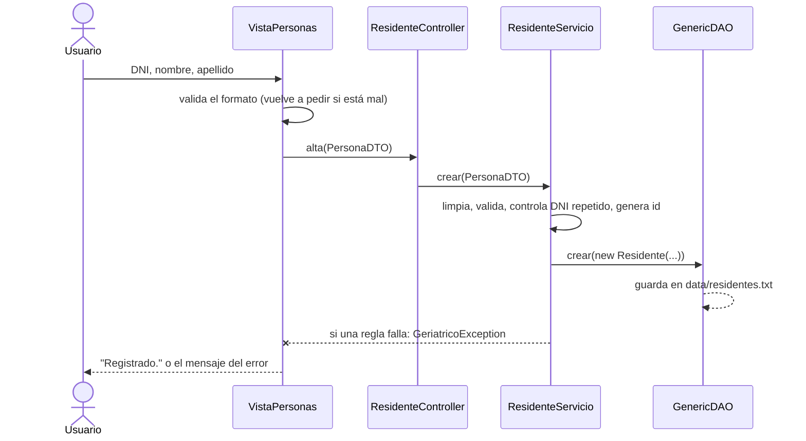

# Gestión de Residencia Geriátrica

Sistema de consola en Java para administrar una residencia geriátrica: residentes, enfermeros, habitaciones, quién ocupa cada habitación y qué enfermero la atiende.

Proyecto de **Programación II** (INSPT-UTN). Es la versión 2 del parcial, rehecha aplicando POO, principios SOLID y una arquitectura **MVC en capas** con persistencia en archivos de texto.

La consigna original del parcial, y dónde se cumple cada punto, está en [docs/CONSIGNA.md](docs/CONSIGNA.md).

---

## Qué hace

| Menú | Operaciones |
|---|---|
| Residentes | Alta, listado, modificación y baja |
| Enfermeros | Alta, listado, modificación y baja |
| Habitaciones | Alta (código automático), listado (libre / ocupada), consulta (quién la ocupa y quién la atiende) y baja |
| Reservas | Asignar una habitación a un residente y liberarla. Antes muestra los residentes sin habitación y las habitaciones libres |
| Asignaciones | Asignar un enfermero a una habitación y quitarlo. Antes muestra los enfermeros y las habitaciones sin enfermero |
| Consultas | Residente con su habitación · Residentes de un enfermero · Enfermero de un residente |

Las habitaciones no tienen "modificar" a mano: su código es su identidad, y quién la ocupa o la atiende se cambia desde las reservas y las asignaciones.

### Reglas de negocio

- El DNI tiene 7 u 8 números y no se repite entre residentes y enfermeros.
- Nombre y apellido llevan solo letras y espacios; se guardan prolijos (`"  juan   carlos"` → `"Juan Carlos"`).
- Los ids y los códigos se generan solos: residentes desde 1001, enfermeros desde 2001 y habitaciones desde HAB-101. Nunca se reutilizan, aunque se borre el registro (el último número usado se guarda en `data/ultimo-*.txt`).
- Un residente ocupa como máximo **una** habitación, y una habitación tiene como máximo **un** residente.
- Un enfermero puede atender **varias** habitaciones, pero cada habitación tiene como máximo **un** enfermero.
- La reserva y la asignación se guardan **dentro de la habitación** (`idResidente` e `idEnfermero`, vacíos si no hay). La habitación está ocupada cuando tiene un residente: no hay un campo `ocupada` aparte que se pueda desincronizar.
- No se puede borrar nada que esté en uso: un residente con habitación, un enfermero con asignaciones o una habitación ocupada o con enfermero.

### Modelo de datos: 3 archivos

```
residentes.txt     1001,20345678,Rosa,Fernández
enfermeros.txt     2001,33456789,Lucía,Pérez
habitaciones.txt   HAB-101,1001,2001      ← código, residente que la ocupa, enfermero que la atiende
                   HAB-104,,              ← libre y sin enfermero
```

Ninguna relación es *muchos a muchos* (residente ↔ habitación es uno a uno; enfermero → habitaciones es uno a muchos), así que no hace falta un archivo intermedio: alcanza con guardar el id del otro lado dentro de la habitación. Reservar es guardar el `idResidente`; liberar es dejarlo vacío.

> Una versión anterior tenía 5 archivos (con `reservas.txt` y `asignaciones.txt`) y quedó en el historial de git. Un archivo intermedio solo hace falta si la relación es muchos a muchos o tiene datos propios (por ejemplo, fecha de ingreso).

---

## Cómo funciona

### Las capas

Cada capa solo conoce a la de abajo. El `Main` es el único lugar que crea las clases concretas y las conecta.



### Ejemplo: dar de alta un residente





### Qué hace cada paquete

| Paquete | Responsabilidad |
|---|---|
| `modelos` | Las entidades. `Persona` es abstracta; `Residente` y `Enfermero` la heredan. `Habitacion` guarda su residente y su enfermero, y es inmutable: reservar o asignar crea una copia (`conResidente`, `conEnfermero`) que el DAO guarda con `actualizar`. |
| `dto` | Objetos que viajan entre la vista y los servicios (`PersonaDTO`, `HabitacionDTO`, `HabitacionDetalleDTO`, `PersonaHabitacionDTO`). La vista nunca toca una entidad real. |
| `dao` | Persistencia. `GenericDAO<T, ID>` es el contrato; `ArchivoDAO` tiene escrita una sola vez la lógica de archivos y cada DAO concreto solo dice cómo pasar su entidad a una línea de texto y al revés. |
| `servicios` | Las reglas de negocio. `PersonaServicio<T>` reúne lo común a residentes y enfermeros. Reciben los DAO por constructor. |
| `controllers` | Puerta de entrada desde la vista. No tienen lógica: en la versión con Spring pasan a ser los `@RestController`. |
| `vistas` | Menús de consola. Es la única capa que usa `System.out` y el teclado, y la que atrapa las excepciones para mostrar el mensaje. |
| `excepciones` | `GeriatricoException` y sus hijas: el nombre de cada una dice qué salió mal. |

Los diagramas UML completos están en [docs/UML.md](docs/UML.md).

---

## Conceptos aplicados

| Concepto | Dónde se ve |
|---|---|
| Herencia y clases abstractas | `Persona` → `Residente`, `Enfermero` · `ArchivoDAO` · `PersonaServicio` · `GeriatricoException` |
| Polimorfismo | `toString()` de `Persona` usa `getRol()` · `MenuPrincipal` muestra cualquier `Vista` · una sola `VistaPersonas` para dos tipos de persona |
| Encapsulamiento | Atributos `private final`, ids sin setter, `listarTodos()` devuelve una copia |
| Genéricos | `GenericDAO<T, ID>`, `ArchivoDAO<T, ID>`, `PersonaServicio<T extends Persona>` |
| **S** — Responsabilidad única | Un servicio por tema; la vista solo muestra, el DAO solo guarda |
| **O** — Abierto/cerrado | Una pantalla nueva es una línea `menu.registrar(...)` en el `Main`, sin tocar `MenuPrincipal` |
| **L** — Sustitución de Liskov | Cualquier `Persona` o `Vista` se usa donde se espera la clase padre |
| **I** — Segregación de interfaces | Interfaces chicas: `GenericDAO`, `Vista`, `PersonaController` |
| **D** — Inversión de dependencias | Los servicios dependen de `GenericDAO`, no de la clase de archivo. Pasar a MySQL es cambiar 3 líneas del `Main`. |

---

## Cómo ejecutarlo

**Requisitos:** JDK 21 y Maven (NetBeans ya trae Maven).

**Desde NetBeans:** abrir la carpeta del proyecto y ejecutar con **F6**.

**Desde la terminal**, en la carpeta del proyecto:

```bash
mvn compile exec:java
```

La carpeta `data/` trae datos de ejemplo: 4 residentes, 3 enfermeros, 5 habitaciones (3 ocupadas y con enfermero). Los cambios que hagas se guardan ahí y se conservan entre ejecuciones. Si borrás la carpeta, el programa arranca vacío y la vuelve a crear.

---

## Estructura

```
src/main/java/prog2/gestiongeriatrica/
├── GestionGeriatrica.java   arma el sistema y lo arranca
├── modelos/                 Persona, Residente, Enfermero, Habitacion
├── dto/                     PersonaDTO, HabitacionDTO, HabitacionDetalleDTO, PersonaHabitacionDTO
├── dao/                     GenericDAO, ArchivoDAO, un DAO por entidad y SecuenciaDAO
├── servicios/               PersonaServicio, Residente/Enfermero/Habitacion/Reserva/Asignacion/ReporteServicio
├── controllers/             PersonaController y un controller por servicio
├── vistas/                  Vista, MenuPrincipal, Consola y una vista por menú
└── excepciones/             GeriatricoException y sus hijas
```

---

## Próximos pasos

1. **MySQL:** agregar DAO con JDBC que implementen `GenericDAO`. Los servicios no cambian.
2. **Spring Boot:** misma estructura con `@Entity`, `JpaRepository`, `@Service` y `@RestController`, probada con Postman.

---

**Autor:** Emanuel Morano Solé · Programación II · Turno Noche
