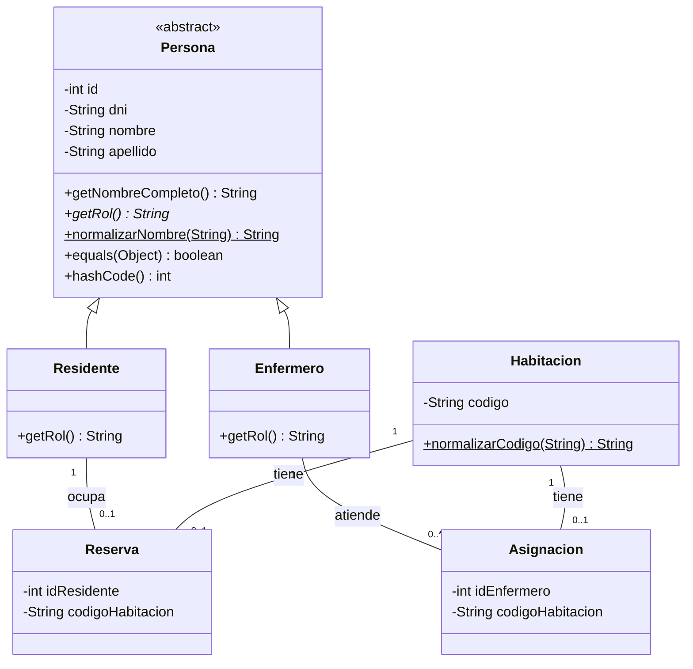
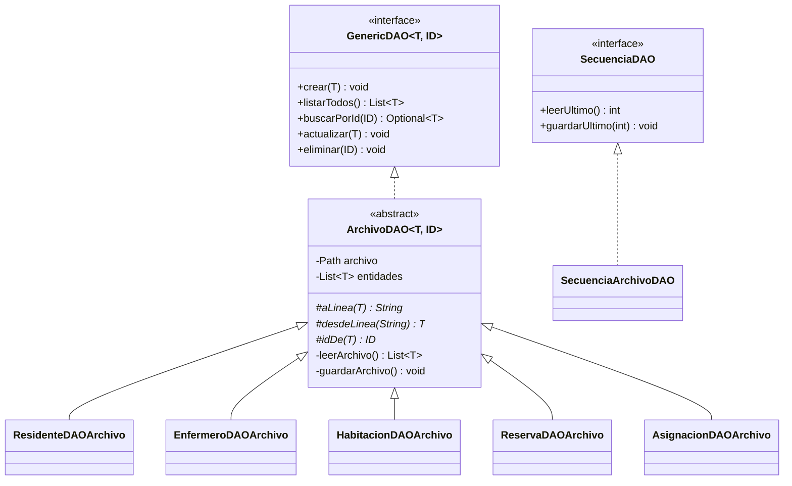
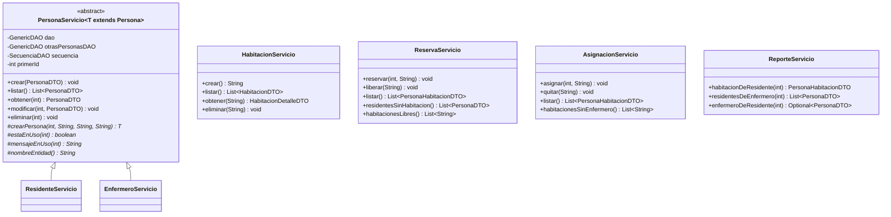
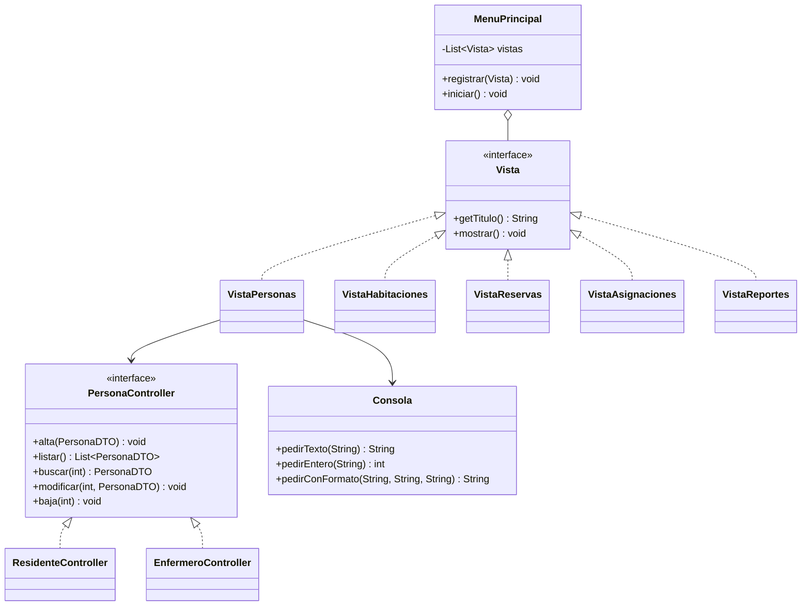
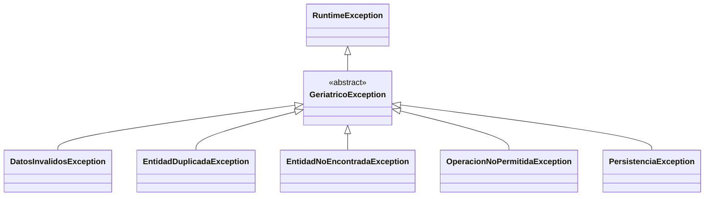

# UML — Gestión de Residencia Geriátrica

[← Volver al README](../README.md)

## 1. Modelos

`Habitacion` no tiene un campo `ocupada`: se calcula buscando si existe una `Reserva` con su código.

## 2. Persistencia (DAO)

`SecuenciaDAO` guarda el último id o código usado (`data/ultimo-residente.txt`, `ultimo-enfermero.txt`, `ultima-habitacion.txt`), así no se repite aunque se borre el registro.

| DAO | `T` | `ID` | Línea en el archivo |
|---|---|---|---|
| `ResidenteDAOArchivo` | `Residente` | `Integer` | `1001,30111222,Juan,Perez` |
| `EnfermeroDAOArchivo` | `Enfermero` | `Integer` | `2001,28999111,Ana,Diaz` |
| `HabitacionDAOArchivo` | `Habitacion` | `String` | `HAB-101` |
| `ReservaDAOArchivo` | `Reserva` | `String` (código) | `1001,HAB-101` |
| `AsignacionDAOArchivo` | `Asignacion` | `String` (código) | `2001,HAB-101` |

## 3. Servicios

Todos los servicios reciben sus `GenericDAO` por constructor y nunca hacen `new` de un DAO.

**DTO:** `PersonaDTO` (con `desde(Persona)` para armarlo desde la entidad) · `HabitacionDTO` (código y si está ocupada) · `HabitacionDetalleDTO` (código, residente y enfermero) · `PersonaHabitacionDTO` (una persona con el código de su habitación; se usa en las reservas, las asignaciones y la consulta 1).

## 4. Vista y controllers

`VistaPersonas` usa la interfaz `PersonaController`, por eso la misma pantalla sirve para residentes y enfermeros. Cada controller recibe su servicio por constructor.

## 5. Excepciones

| Excepción | Cuándo se lanza |
|---|---|
| `DatosInvalidosException` | Un dato no tiene el formato correcto (DNI con letras, nombre con números) |
| `EntidadDuplicadaException` | DNI o código de habitación repetido |
| `EntidadNoEncontradaException` | Id o código que no existe |
| `OperacionNoPermitidaException` | Se viola una regla (habitación ocupada, borrar algo en uso) |
| `PersistenciaException` | Falla la lectura o escritura de los archivos |

Los servicios las lanzan y las vistas las atrapan como `GeriatricoException` para mostrar el mensaje.
